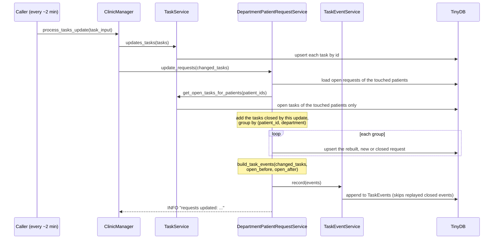
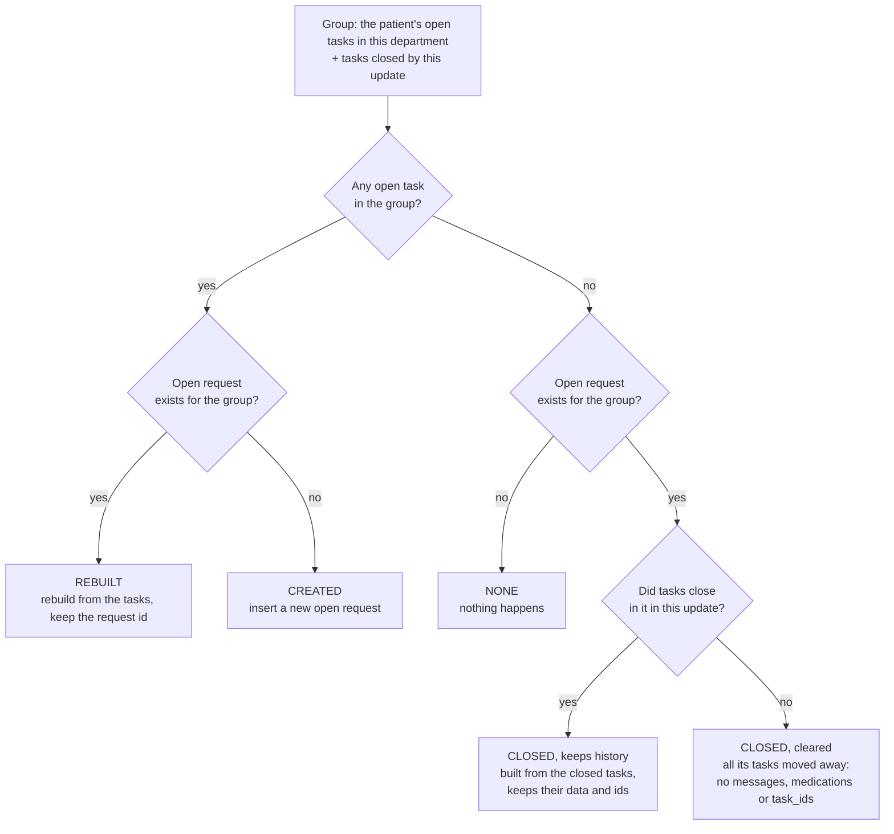
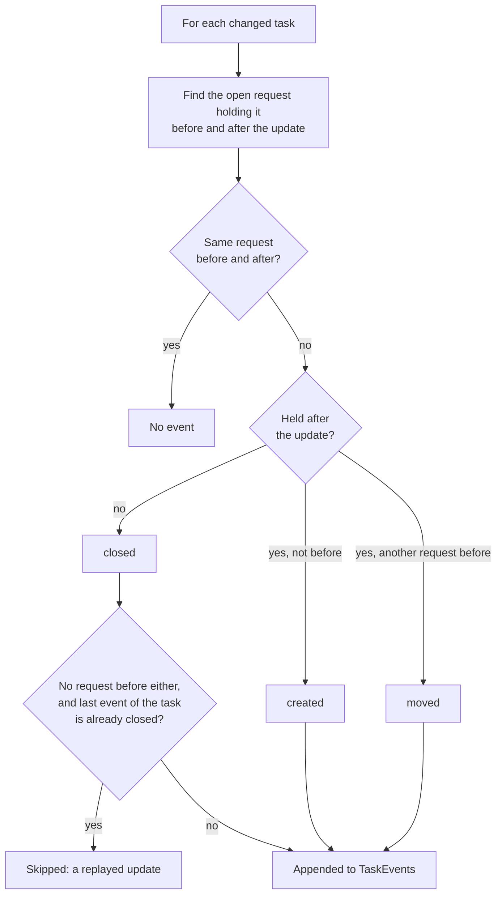

# Flow of a tasks update

Diagrams for [CHANGES.md](CHANGES.md) section 2.4. Run with `python main.py`, or call
`ClinicManager.process_tasks_update(task_input)`.

## 1. From update to requests and events

## 2. Reconcile of one group `(patient_id, department)`

A closed request is never reopened. A new task for that department creates a new open request.

## 3. How an event is decided

## 4. Example: the sample data

| Update | What happens | Requests | Events |
|---|---|---|---|
| 1 | six tasks arrive | 5 created (patient1 Primary, patient2 Primary, patient2 Dermatology, patient3 Radiology, patient3 Primary) | 6 `created` |
| 2 | `task1`, `task2`, `task4` close, `task3` moves Radiology to Primary, `task400` arrives | 3 rebuilt (patient2 Primary without `task2`, patient2 Dermatology, patient3 Primary), 2 closed (patient1 Primary with its data, patient3 Radiology cleared) | 3 `closed`, 1 `moved`, 1 `created` |
| 3 | `task3`, `task5`, `task6`, `task400` close, `task5` moves Dermatology to Primary | 3 closed: patient3 Primary and patient2 Primary keep their data, patient2 Dermatology is cleared | 4 `closed` |
| 4 | `task7` arrives | 1 created | 1 `created` |
